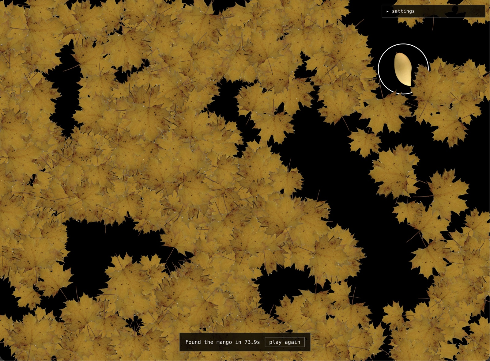
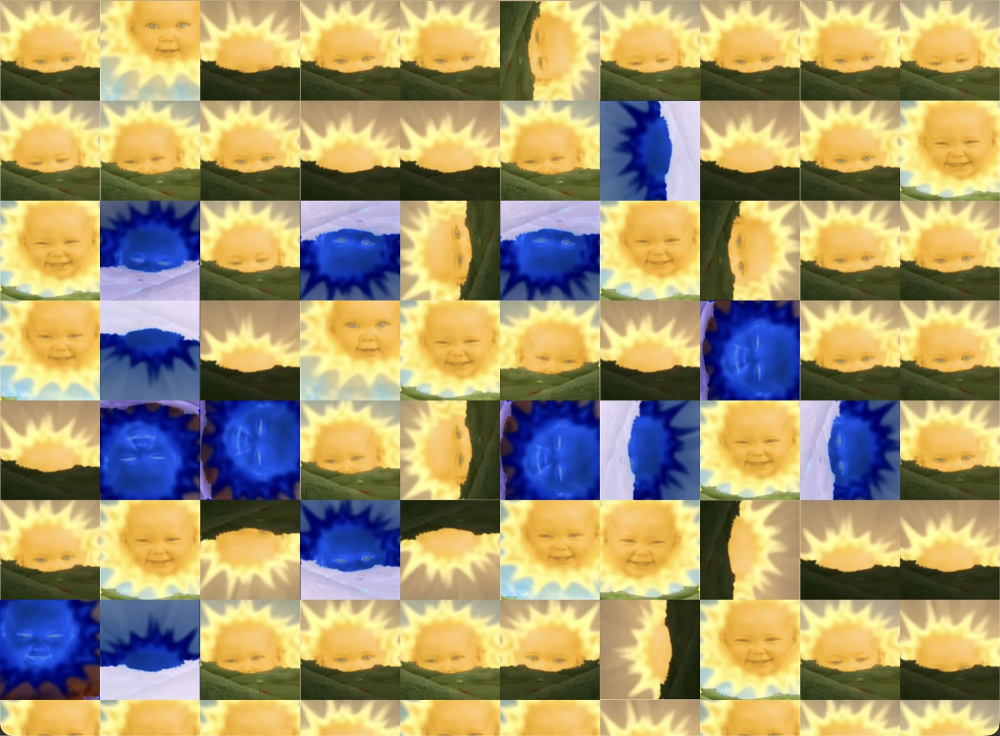

# id412-2026

KAIST ID412 Interactive Space — Web Workshop (Web 1–3). Lecture notes and the template every student builds in.

Lecture notes: https://id412.xdlab.net

## My experiments

| Experiment | Route | Idea |
| --- | --- | --- |
| Time Interval | `/experiments/w1/time-interval` | A single number counting 0 → 100, then starting over. |
| Time Drawing | `/experiments/w1/time-drawing` | Drawing with numbers: a grid of 0–9 where the cursor's dwell time lights up and changes the numbers it stays on. |
| 가을 낙엽 속 망고 찾기 | `/experiments/w1/mango-hunt` | A game: sweep away a pile of yellow autumn leaves and find the one mango hidden underneath. |
| Baby Sun Grid | `/experiments/w1/baby-sun-grid-click` | The Teletubbies baby sun tiled across the screen, out of sync; click a cell to rotate, flip or invert it. |

**Time Drawing — concept.** To draw something, the pen has to travel along its path. A pen passing over a spot = the pen staying there for a while = time. So: lay out a grid of numbers; where the cursor stays, the number lights up and keeps changing, and what you have drawn is left behind in numbers. Details in `app/experiments/w1/time-drawing/README.md`.


**가을 낙엽 속 망고 찾기.** A pale yellow mango hides under 1000 yellow maple leaves. It's almost the same colour as the leaves. Drag to sweep the leaves aside, click the mango once you spot it, and see how long it took. A foldable settings panel changes how hard the sweep pushes, the brush size, friction, and how many leaves there are. Details in `app/experiments/w1/mango-hunt/README.md`.



**Baby Sun Grid.** The Teletubbies baby sun video, cropped to a square and repeated in small cells that fill the screen. Every cell starts at a random point, so the suns rise and smile out of sync. Click a cell and it gets a new random look: turned by 90°, mirrored, and/or color-inverted. Details in `app/experiments/w1/baby-sun-grid-click/README.md`.



## Setup

Requires Node.js LTS (24 or newer) and pnpm.

1. GitHub: **Use this template** → create your own repository
2. `git clone <your repository>`
3. `pnpm install`
4. `pnpm dev` → http://localhost:3000

## Scripts

| Script            | What it does                                                                 |
| ----------------- | ---------------------------------------------------------------------------- |
| `pnpm dev`        | Next.js on http://localhost:3000. Enough for W1 and single-device work.      |
| `pnpm dev:mobile` | Next.js over HTTPS on all interfaces + socket relay on port 4000. For phones. |
| `pnpm build`      | Production build (what Vercel runs).                                         |
| `pnpm typecheck`  | `tsc --noEmit`.                                                              |

`pnpm dev:mobile` generates a self-signed certificate into `certificates/` on first run. On the phone, open both `https://<laptop-ip>:3000` and `https://<laptop-ip>:4000` once and pass the warning. See W2 notes, A3.

## One repo, three areas

The same `lecture / experiments / final` split runs through `app/`, `public/`, `hooks/` and `docs/`:

```
app/
  lecture-materials/    the lecture website (instructor territory)    → docs/lecture-materials/
  experiments/      your experiments, w1/ w2/ w3/, one folder each → docs/experiments/
  final/            your final project                            → docs/final/
  api/              server endpoints (W3)
public/   lecture-materials/  experiments/<week>/<name>/  final/            assets, same split
hooks/    shared/useSocket.ts  experiments/  final/               hooks, same split
docs/     lecture-materials/  experiments/  final/  sources/                guides, one per area
socket-server.mjs                                                 Socket.IO relay (port 4000)
AGENTS.md                                                         rules for coding agents; points to docs/
```

- An experiment is `app/experiments/<week>/<kebab-name>/page.tsx` (+ `page.module.css`, helpers, `README.md`) → `/experiments/<week>/<kebab-name>`.
- Multi-device: `mobile/page.tsx` and `screen/page.tsx` inside the experiment, both calling `useSocket("<kebab-name>", ...)` from `hooks/shared/useSocket.ts`.
- The lecture pages exist in English and Korean (`en.mdx` + `ko.mdx`); the switch is in the sidebar.

## From experiment to final

See `docs/final/README.md`. In short: copy the experiment into `app/final/`, give it its own socket room, grow it there, keep `pnpm build` green.

## Deploy

Push to GitHub → Vercel → Import → Deploy. The deployed site has no socket relay: multi-device work runs from your laptop with `pnpm dev:mobile`.
