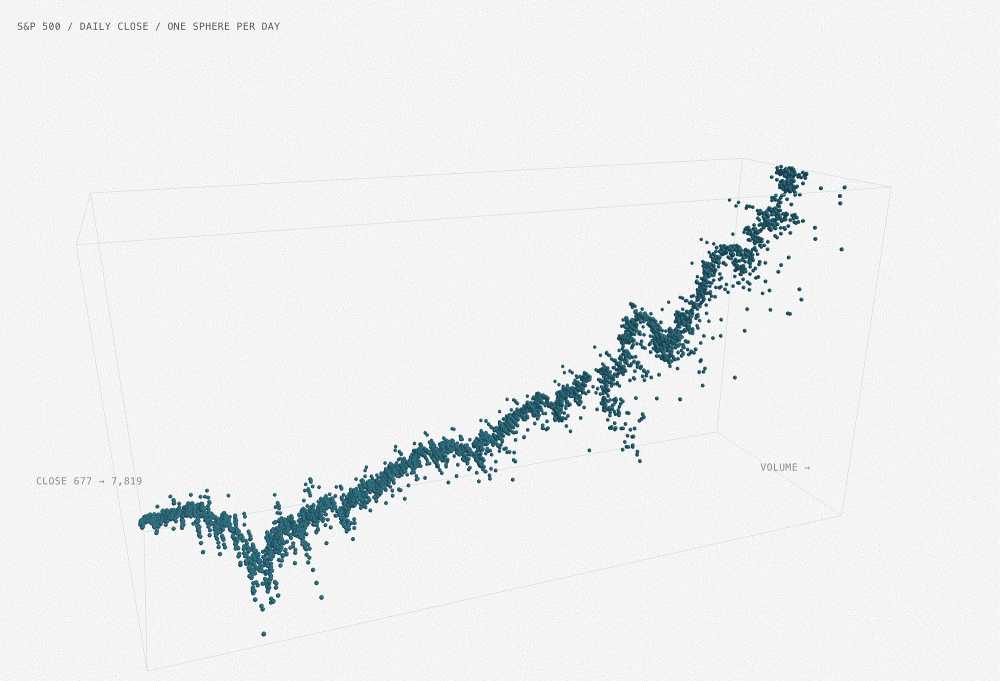

# S&P 500 Spheres

The S&P 500 line (2006–2026) inside a 3D box you can orbit. Each trading day is one small teal sphere. Hover a sphere to read its date, close and volume.

- Route: /experiments/w1/sp500-spheres
- Week: W1 · Tech: Three.js
- Inputs: drag (orbit), scroll (zoom), hover (readout)
- Parameters: BOX (12 × 6 × 4), RADIUS (0.035), both in `Chart.tsx`

## How it works
- `sp500.csv` (date, close, volume; Yahoo Finance ^GSPC) is fetched once in `page.tsx`. One day with volume 0 reuses the day before.
- x = trading day, y = close (linear), z = volume. Each axis is scaled from its min..max to the box size (`positionOf`).
- All ~5000 spheres are one `InstancedMesh`: positions are set once, drawn in one call.
- Hover uses the instance id from the pointer event; the readout (top left) and the black highlight sphere follow it.
- Colours from `tokens.ts` (cheney design system). Grain covers the 3D view only.
- 3D take on `sp500-line`.

## Run
pnpm dev → http://localhost:3000/experiments/w1/sp500-spheres

## Status / next
Works. Next: switch z between volume / daily change / flat 0.
