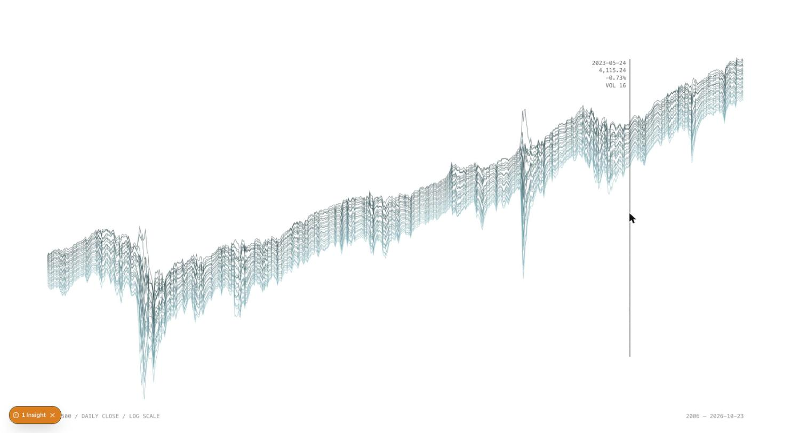

# S&P 500 Threads

Twenty years of S&P 500 daily closes (2006–2026) drawn as a bundle of teal threads that follow the price. Calm markets keep the threads tight; volatile stretches (2008, 2020, 2022) make them spread and fray. Hover to read a day, click to replay.

- Route: /experiments/w1/sp500-threads
- Week: W1 · Tech: Canvas
- Inputs: mouse x (date readout), click (replay), time (threads breathe)
- Parameters (top of `page.tsx`): THREADS (28), SPACING (2.2 px), FRAY (90 px), SPEED (12 days/frame), VOL_EASE (0.05)

## How it works
- `sp500.csv` (date, close, volume; Yahoo Finance ^GSPC) is fetched once. Each day gets its daily change and `vol`: a running average of |change| (`VOL_EASE`), scaled to 0..1.
- y is the log of the close, so a 10% move looks the same size in 2006 and 2026.
- About one point is drawn every 2 px. Each point takes the most volatile day in its step, so short crashes don't get skipped.
- Each thread sits at its own offset from the price line. The offset grows with `vol`, and two sine waves add wander scaled by `vol²` × `FRAY`, so only really volatile days fray.
- Colours come from `tokens.ts` (copied from the cheney design system): one two-colour gradient teal 900 → 300 across the threads, white background, CSS film grain overlay.

## Run
pnpm dev → http://localhost:3000/experiments/w1/sp500-threads

## Status / next
Works. The data stops at 2026-10-23. Next idea: map volume to thread thickness, or play a quiet tone whose roughness follows `vol` (Tone.js).
