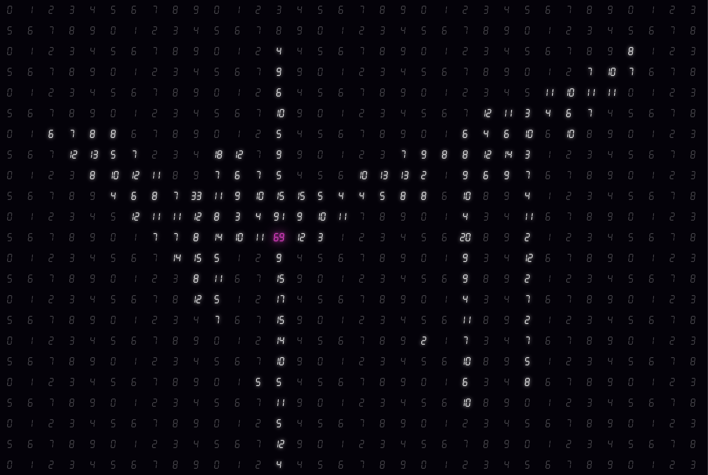

# Time Drawing

A dense full-screen grid of square cells showing 0–9 as neon seven-segment (digital clock) digits. Hover a cell and it becomes a timer that ticks up; move away and it freezes at that count. A color toggle in the lower right sets the two neon colors (default: white grid, pink ticking). The cursor is a hollow white ring so it never hides a number.

- Route: /experiments/w1/time-drawing
- Week: W1 · Tech: React state + setInterval, SVG, CSS Modules
- Inputs: mouse hover, time, color picker
- Parameters: CELL_SIZE (36 px), MAX_COUNT (100), INTERVAL (100 ms), DEFAULT_NEON / DEFAULT_ACTIVE_NEON

## Concept
Drawing, but with numbers.
- To draw something, the pen has to travel along its path.
- A pen passing over a spot = the pen staying at that spot for a while.
- Staying = time.
- So: lay out a grid of numbers. Where the cursor stays, the number lights up and keeps changing, and what you have drawn is left behind in numbers.

## How it works
- On load and on resize, the page computes how many `CELL_SIZE` squares cover the window (rounded up, overflow hidden).
- Each `Cell` starts at `index % 10` and keeps its own `count` and `hovered` state.
- `onMouseEnter` starts a `setInterval` in that cell only; `onMouseLeave` clears it, so the count stays where it stopped.
- Counts wrap from `MAX_COUNT` back to 0. Dim neon = untouched, glowing neon = frozen timer, ticking color = ticking.
- `SevenSegment.tsx` draws each digit as 7 SVG polygons (no font needed); glow is CSS `drop-shadow`.
- `Controls.tsx` holds two `<input type="color">`; colors go onto `<main>` as CSS variables `--neon` and `--active-neon`.
- `CELL_SIZE` also appears in `page.module.css` (`grid-auto-rows`); change both together.

## Run
pnpm dev → http://localhost:3000/experiments/w1/time-drawing

## Status / next
Works. Grown from `../time-interval` (a single counter). Next: let stopped timers slowly drift back to their digit, or tie speed to mouse velocity.
